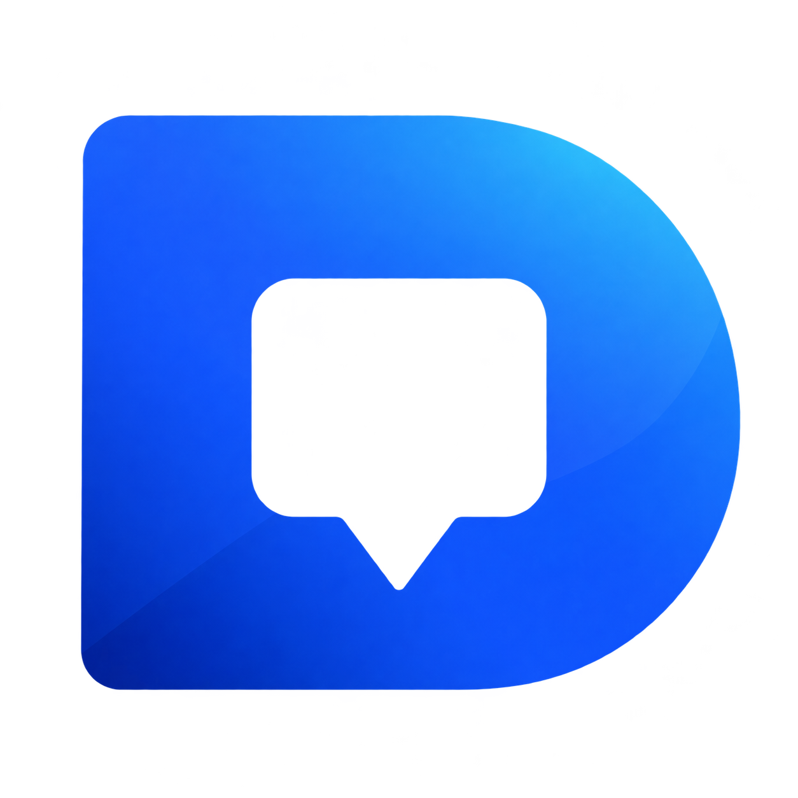
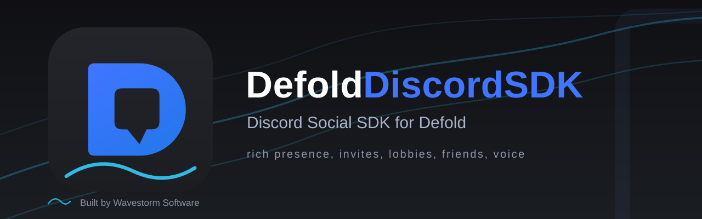

# DefoldDiscordSDK

<p align="center">
  
</p>



[](wiki/Platform-Support.md)
[](LICENSE.md)
[](https://defold.com)
[](https://github.com/WavestormSoftware/DefoldDiscordSDK/releases/latest)
[](https://github.com/WavestormSoftware/DefoldDiscordSDK/actions)

`DefoldDiscordSDK` is a native Defold extension that fully integrates the modern Discord Social SDK. It replaces the old, deprecated `discordrich` extension that was built on the discontinued discord-rpc client library.

DefoldDiscordSDK is built and maintained by [Wavestorm Software](https://wavestorm.net/). Software. Games. Websites.

The extension works in two modes:

- **Presence mode (no login).** Rich presence is set through direct RPC to a running Discord desktop client (or the Discord app on Android). No account linking, no OAuth, no scopes.
- **Full social mode (after account linking).** After a one-time OAuth authorization the game unlocks the full social layer: a unified friends list (Discord friends plus in-game Game Friends), game invites with deep links that drop players into exact sessions, client-side lobbies with text chat, metadata and history, and lobby voice chat with optional krisp noise cancellation.

The Discord Social SDK binaries are proprietary and are not committed to this repository. They are staged locally with the fetch tool in `tools/`, or resolved at run time from a folder you configure. Because the extension binds Discord's C ABI and loads the library at run time, it compiles on Defold's cloud build service without the SDK present. If the library is missing at run time the extension fails loudly: the boot log prints a clear error telling you to add the SDK, and every `discordsdk.*` call returns false until it is installed.

## Features

| Feature | Description | Documentation |
| --- | --- | --- |
| Rich presence | Full activity payload: details, state, timestamps, assets, party, secrets, buttons, platform routing | [wiki/Rich-Presence.md](wiki/Rich-Presence.md) |
| Presence without login | Direct RPC to a running desktop or Android Discord client | [wiki/Rich-Presence.md](wiki/Rich-Presence.md) |
| Game invites | Programmatic invites, ask-to-join requests, accept flow, deep-link joins | [wiki/Game-Invites-and-Joining.md](wiki/Game-Invites-and-Joining.md) |
| Lobbies | Create or join by secret, metadata, member lifecycle, text chat with history | [wiki/Lobbies.md](wiki/Lobbies.md) |
| Voice | Lobby voice calls, audio devices, muted, deafened, krisp noise cancellation | [wiki/Voice.md](wiki/Voice.md) |
| Friends and relationships | Unified friends list, Discord and game relationship types, groups, live updates | [wiki/Friends-and-Relationships.md](wiki/Friends-and-Relationships.md) |
| OAuth account linking | Authorize, persist tokens, refresh, revoke | [wiki/OAuth-and-Tokens.md](wiki/OAuth-and-Tokens.md) |
| Launch registration | Protocol launch command and Steam registration so Discord can start your game | [wiki/Game-Invites-and-Joining.md](wiki/Game-Invites-and-Joining.md) |

## Platform support

| Platform | Status |
| --- | --- |
| Windows x86_64 | Supported, desktop first target |
| macOS x86_64 and arm64 | Supported, universal build |
| Linux x86_64 | Supported, desktop first target |
| Android | SDK supported; mobile integration is a documented later phase; extension currently compiles with stubs |
| iOS | SDK supported; later phase; stubs; rich presence via RPC is not supported on iOS |
| HTML5 | No-op, all calls degrade gracefully |
| Consoles | Future; device-code OAuth is a documented future possibility and is currently discouraged |

See [wiki/Platform-Support.md](wiki/Platform-Support.md) for details.

## Quick start

1. **Prerequisites.** Install Defold. For presence mode you need a running Discord desktop client on the test machine (or the Discord app on Android). For the social layer, create a Discord application at the Developer Portal and enable the Social SDK for the application under App, then Getting Started.
2. **Add the extension.** Preferred: point Defold's project dependencies at a tagged release zip. In `game.project`:

   ```project
   [project]
   dependencies = https://github.com/WavestormSoftware/DefoldDiscordSDK/archive/refs/tags/v1.0.0.zip
   ```

   See the [Releases](#releases) section below for all URL forms. Alternatively, copy the `defolddiscordsdk/` folder into your project, or add the bare repository URL (`https://github.com/WavestormSoftware/DefoldDiscordSDK`) in the editor under Project, then Dependencies.
3. **Stage the SDK binaries.** Download the latest C++ variant of the Discord Social SDK from the Downloads page under your application and run the fetch tool:

   ```bash
   tools/fetch_discord_sdk.sh /path/to/discord_social_sdk.zip
   ```

   The tool stages the platform libraries, and optionally the krisp voice libraries and .kef models, into the extension's `res/` folders. See [wiki/Installation.md](wiki/Installation.md) for the full procedure and for the advanced `lib_path` workflow.
4. **Set the application id.** Add the section to `game.project` and replace the id with your own:

   ```project
   [defolddiscordsdk]
   application_id = 1349146942634065960
   ```

## Rich presence quickstart

```lua
local discordsdk = require "discordsdk"

function init(self)
    discordsdk.initialize({
        -- presence only: no account linking required
        application_id = "1349146942634065960",
    })

    discordsdk.update_presence({
        details = "Exploring the Forgotten Vale",
        state = "Match 3 of 5",
        status_display_type = discordsdk.DISPLAY_DETAILS,
        timestamps = { start_ts = os.time() },
        assets = { large_image = "world-map", large_text = "Forgotten Vale" },
    })
end
```

Discord shows the presence about a minute later in the user's profile and friends list. Rate limiting is handled by the extension: updates are queued and deduplicated, at most five per twenty seconds.

## Account linking quickstart

```lua
local discordsdk = require "discordsdk"

function init(self)
    discordsdk.initialize({
        application_id = "1349146942634065960",
        scopes = discordsdk.scopes_communication, -- full social layer
    })

    discordsdk.set_callback("authorized", function()
        local user = discordsdk.get_current_user()
        if user then
            print("account linked as " .. tostring(user.display_name))
        end
    end)

    discordsdk.set_callback("activity_join", function(payload)
        -- payload.secret lets you connect the player to the exact session
        print("join secret: " .. tostring(payload.secret))
    end)

    discordsdk.authorize()
end
```

The `authorized` callback fires when the browser flow completes. See [wiki/OAuth-and-Tokens.md](wiki/OAuth-and-Tokens.md) for persisting tokens with `sys.save`, refreshing, and revoking.

## Configuration

All keys live in the `[defolddiscordsdk]` section of `game.project`. The section is registered with the editor through the extension's `ext.properties` file, so it shows up in the `game.project` settings pane under the category **Defold Discord SDK** (Runtime group) with per-field labels and help tooltips - no manual INI editing needed. Options can also be passed per call to `discordsdk.initialize()`. Defaults shown.

| Key | Default | Description |
| --- | --- | --- |
| `application_id` | empty | Numeric Discord application id from the Developer Portal. |
| `lib_path` | empty | Run-time fallback folder where the extension looks for the SDK binaries. Use only for the advanced install workflow. |
| `steam_app_id` | empty | Steam app id used to register the Steam launcher so invite deep links start the game from Steam. |
| `default_redirect` | empty | Overrides the OAuth redirect used by `authorize()`. Leave empty unless you host your own redirect page. |
| `scopes` | `presence` | `presence` for rich presence and friends, or `communication` to include the full social layer. `communication` is a superset. |
| `auto_register_launch` | `1` | Registers the protocol and launch command so Discord can start your game when a player opens an invite. Set `0` to register manually with `discordsdk.register_launch_command()`. |

Full reference: [wiki/Configuration.md](wiki/Configuration.md).

## API summary

| Function group | Functions | Documentation |
| --- | --- | --- |
| Lifecycle and callbacks | `initialize`, `connect`, `disconnect`, `set_callback`, `get_status`, `is_ready`, `version` | [wiki/API-Reference.md](wiki/API-Reference.md) |
| Presence | `update_presence`, `clear_presence` | [wiki/Rich-Presence.md](wiki/Rich-Presence.md) |
| Invites and joining | `send_invite`, `accept_invite`, `send_join_request`, `send_join_request_reply`, `get_launch_args`, `register_launch_command`, `register_steam` | [wiki/Game-Invites-and-Joining.md](wiki/Game-Invites-and-Joining.md) |
| Lobbies | `lobby_join_or_create`, `lobby_leave`, `get_lobbies`, `lobby_send_message`, `lobby_get_messages` | [wiki/Lobbies.md](wiki/Lobbies.md) |
| Voice | `start_voice`, `stop_voice`, `stop_all_voice`, control getters and setters, audio device selection | [wiki/Voice.md](wiki/Voice.md) |
| Friends | `get_friends`, `get_friend`, relationship events | [wiki/Friends-and-Relationships.md](wiki/Friends-and-Relationships.md) |
| OAuth and tokens | `authorize`, `set_token`, `clear_token`, `refresh_token`, `revoke_token`, `is_authenticated` | [wiki/OAuth-and-Tokens.md](wiki/OAuth-and-Tokens.md) |
| User status | `set_online_status`, `get_current_user`, `user_updated` events | [wiki/Friends-and-Relationships.md](wiki/Friends-and-Relationships.md) |

The exact Lua surface, every constant, and every event payload is documented in [wiki/API-Reference.md](wiki/API-Reference.md). Every function degrades gracefully: when the SDK library is unavailable the module returns `false`, `nil`, or empty tables so the game keeps running.

## Releases

Every tag pushed to this repository in the form `1.0.0` or `v1.0.0` triggers the release workflow, which runs automatically and creates the GitHub release for you. This repository's released tags use the `v` prefix (`v1.0.0`), and every dependency URL below must spell the tag exactly as it appears in the tag list:

1. All quality gates run: Lua parsing, C API consistency against the vendored header, documentation checks, and the license audit.
2. A GitHub release is published with:
   - `DefoldDiscordSDK-<version>.zip`: the Defold library zip, containing the tag's tracked source code (`git archive`), layout verified before upload
   - `SHA256SUMS-<version>.txt`: integrity checksum for the zip
   - release notes extracted from the matching `CHANGELOG.md` section, plus a ready-to-paste dependency snippet

The zip is pure source: Defold compiles the extension itself through its cloud build service whenever your project builds, so no precompiled engine libraries ship here. To cut a release, commit your changes, tag, and push; everything else is automatic:

```bash
git tag v1.0.1
git push origin v1.0.1
```

The tag may carry a `v` prefix (`v1.0.1`) or not (`1.0.1`), but before tagging the version must have a matching `## [1.0.1]` section in `CHANGELOG.md` (section headings always use the bare version), or the workflow stops before publishing.

Defold accepts the versioned tag archive URL as a project dependency. Reference per-version tags so your build stays reproducible; form shown for tag `v1.0.0`:

```project
[project]
dependencies = https://github.com/WavestormSoftware/DefoldDiscordSDK/archive/refs/tags/v1.0.0.zip
```

The equivalent release asset is `https://github.com/WavestormSoftware/DefoldDiscordSDK/releases/download/v1.0.0/DefoldDiscordSDK-1.0.0.zip` (same content, pinned likewise). Bump the tag in the URL whenever you adopt a newer release. The zip contains `game.project` and `defolddiscordsdk/`, which is the layout Defold's library loader expects. The Discord Social SDK binaries are deliberately not packaged in it; fetch them separately as described below.

## Installing the SDK binaries

Two workflows are supported.

**Workflow one, fetch tool (recommended).** Download the SDK archive from the Discord Developer Portal, under your application. On the application's Getting Started page enable the Social SDK, then open the Downloads page under the app, choose the latest version and the C++ variant. Then run:

```bash
# linux and macos
tools/fetch_discord_sdk.sh /path/to/discord_social_sdk_archive_or_folder

# windows
tools\fetch_discord_sdk.bat C:\path\to\discord_social_sdk_archive_or_folder
```

If you extracted the SDK to a folder named `discord_social_sdk` at the repository root, the tool auto-detects it and you can run it without an argument. The tool stages the libraries into `defolddiscordsdk/res/x86_64-win32/`, `defolddiscordsdk/res/x86_64-osx/`, and `defolddiscordsdk/res/x86_64-linux/`, plus optional krisp voice libraries and .kef noise cancellation models when provided. See `defolddiscordsdk/res/README.md` for the exact output layout.

**Workflow two, custom folder (advanced).** Place the binaries next to your bundled game executables, or in any folder the game can find, and point the extension at it:

```project
[defolddiscordsdk]
application_id = 1349146942634065960
lib_path = /absolute/or/relative/path/to/discord/sdk/binaries
```

In the editor, set it in the **Defold Discord SDK** category of the `game.project` settings pane (field *Discord SDK library location*). The binaries are not committed to the repository and remain under Discord's own terms; see the License section below.

## Testing notes

- You need two Discord accounts. A user never sees their own presence invite and cannot join themselves, so invites and game invites must be tested between accounts.
- Install Discord Canary and Discord PTB next to the stable client. Three signed-in clients on one machine allow simultaneous testing of invite delivery, acceptance, lobby chat, and voice.
- Spamming presence updates is safe: the extension queues and rate limits to five updates per twenty seconds, and identical payloads are deduplicated.
- Lobby operations are rate limited while your application has no increased production limits: one hundred lobby create or join operations and one hundred lobby messages per application per two hours in development mode.
- See [wiki/Testing-Guide.md](wiki/Testing-Guide.md) for a full test matrix.

## Troubleshooting

- **No presence shows and the boot log raises a missing-library error.** Run the fetch tool, or set `[defolddiscordsdk] lib_path` in the editor's Defold Discord SDK category. The game keeps running either way.
- **Presence set but nothing appears in Discord.** Check that the Discord desktop client is running, that Rich Presence is enabled, and that the user has not turned off the Game Activity setting for your app.
- **`authorize()` fails with HTTP 401 or the browser page reports a redirect mismatch.** Check the registered redirect and the `default_redirect` option. See [wiki/OAuth-and-Tokens.md](wiki/OAuth-and-Tokens.md).
- **Join button never appears.** Presence needs `party` with an id and sizes, a `join` secret, and `supported_platforms` set. Checklist in [wiki/Game-Invites-and-Joining.md](wiki/Game-Invites-and-Joining.md).
- **No presence on iOS or web.** Not supported: rich presence via RPC does not work on iOS or web clients, and this extension ships stubs for both.
- **Lobby operations suddenly fail.** Development-mode rate limits: one hundred lobby creations and messages per application per two hours. See [wiki/Lobbies.md](wiki/Lobbies.md).

Full table in [wiki/Troubleshooting.md](wiki/Troubleshooting.md).

## License

The extension code is MIT licensed. See [LICENSE.md](LICENSE.md). The Discord Social SDK binaries are not part of this repository and remain governed by Discord's own terms; by downloading them you accept the Discord Social SDK terms. This distinction is also recorded in the project NOTICE, which references [LICENSE.md](LICENSE.md) for the code license.

DefoldDiscordSDK is not affiliated with, endorsed by, or connected to Discord Inc. or the Defold Foundation. Discord and Defold are trademarks of their respective owners. The Discord Social SDK binaries are fetched separately under Discord's terms; this repository ships no Discord binaries.

## About Wavestorm Software

DefoldDiscordSDK is built and maintained by Wavestorm Software, a small studio in the Netherlands that ships its own software and games and builds fast, well-structured websites. Say hello on the [website](https://wavestorm.net/), in the [community Discord](https://discord.gg/Mx57awWutB), on [Codeberg](https://codeberg.org/Wavestorm), or on [LinkedIn](https://linkedin.com/company/wavestormsw).

## Wiki

| Page | Content |
| --- | --- |
| [wiki/Home.md](wiki/Home.md) | Landing page with the project summary and full page index |
| [wiki/Getting-Started.md](wiki/Getting-Started.md) | First run in five minutes |
| [wiki/Installation.md](wiki/Installation.md) | SDK binaries, fetch tool, and the lib_path workflow |
| [wiki/Configuration.md](wiki/Configuration.md) | All `game.project` keys, initialize options, error modes |
| [wiki/API-Reference.md](wiki/API-Reference.md) | Complete function, constant, and event reference |
| [wiki/Rich-Presence.md](wiki/Rich-Presence.md) | Every presence field and how Discord renders it |
| [wiki/Game-Invites-and-Joining.md](wiki/Game-Invites-and-Joining.md) | Invite lifecycle and join handling |
| [wiki/Lobbies.md](wiki/Lobbies.md) | Client-side lobbies, chat, history, rate limits |
| [wiki/Friends-and-Relationships.md](wiki/Friends-and-Relationships.md) | Unified friends list and relationship events |
| [wiki/Voice.md](wiki/Voice.md) | Lobby voice, devices, noise cancellation |
| [wiki/OAuth-and-Tokens.md](wiki/OAuth-and-Tokens.md) | Account linking and token storage |
| [wiki/Platform-Support.md](wiki/Platform-Support.md) | Per platform behavior and limitations |
| [wiki/Testing-Guide.md](wiki/Testing-Guide.md) | Two-client setup and test matrix |
| [wiki/Updating-the-SDK.md](wiki/Updating-the-SDK.md) | Bumping the SDK version |
| [wiki/Troubleshooting.md](wiki/Troubleshooting.md) | Symptom, cause, fix table |
| [wiki/FAQ.md](wiki/FAQ.md) | Frequently asked questions |
